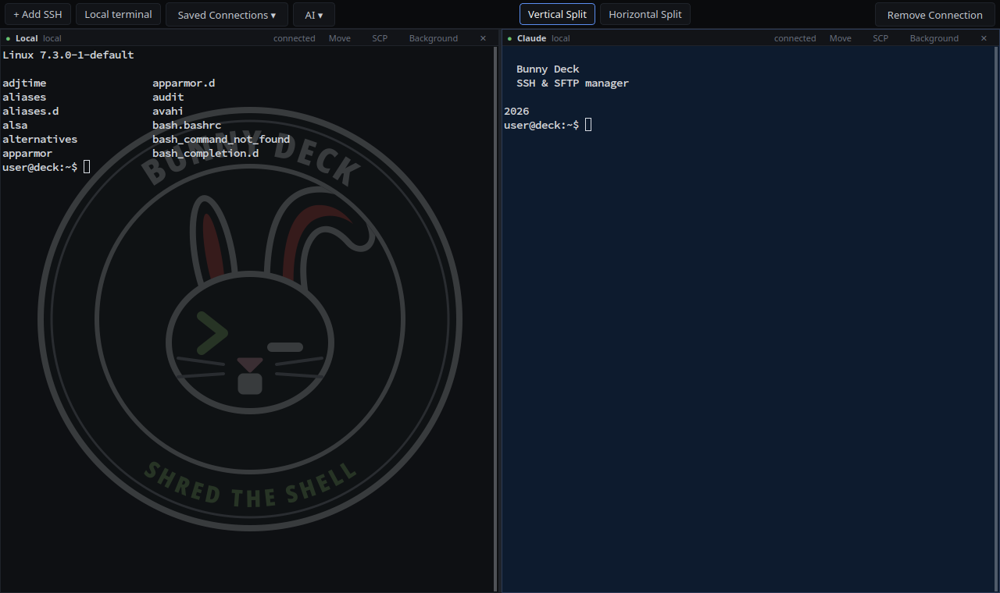

# Bunny Deck

A lightweight, native SSH and SFTP manager for the Linux desktop, built with
Python 3, Qt 6 (PyQt6), QTermWidget and the system OpenSSH. It is made with
KDE Plasma in mind and works on other desktops too.



## Features

- **Real terminals** (QTermWidget, the terminal widget of QTerminal) in one window, side by side or stacked, with draggable dividers and free arrangement (for example one large terminal with two stacked beside it).
- **Saved connections**: name, host or `~/.ssh/config` alias, user and port. Any number of sessions per connection.
- **Integrated SFTP file manager** for each session, with two panes: Local ↔ Remote and Remote ↔ Remote, with drag and drop.
- **Your SSH setup just works**: keys, ssh-agent, `~/.ssh/config` and `known_hosts` are used exactly as on the command line, because Bunny Deck runs the system `ssh`. Passwords are asked when needed and never stored.
- **AI menu**: your own list of command line AI assistants (for example `claude`, `codex` or `opencode`), each opened in its own terminal with one click.
- **Backgrounds**: per connection colour, transparency and an optional background image. Local terminals come with the Bunny Deck badge.

## Installation

Bunny Deck runs from a cloned copy of this repository. It contains a small
Python binding for QTermWidget, because distributions ship QTermWidget
without one; `install.sh` compiles it against the installed library.

### Supported distributions

| Distribution | Status |
|---|---|
| openSUSE Tumbleweed | Developed and used daily |
| Fedora 43 and newer | Built and tested in CI |
| Arch Linux (and derivatives) | Built and tested in CI |
| Debian 13 (trixie) and newer | Built and tested in CI |
| Ubuntu 26.04 and newer | Built and tested in CI |

Older releases (for example Ubuntu 24.04 or Debian 12) ship QTermWidget only
for Qt 5 and are not supported.

### Steps

```bash
git clone https://gitlab.com/zeronulla-group/bunny_deck.git
cd bunny_deck
./install-deps.sh     # installs the packages below (asks for sudo)
./install.sh          # builds the binding, adds the app to your application menu
```

Then start **Bunny Deck** from the application menu, or run `./bunny-deck`
from the project directory.

`install.sh` writes only two files outside the project, and `./uninstall.sh`
removes them again. Your settings in `~/.config/bunny-deck/` are kept.

- `~/.local/share/applications/org.bunnydeck.BunnyDeck.desktop`
- `~/.local/share/icons/hicolor/scalable/apps/bunny-deck.svg`

Because the menu entry points to the cloned directory, keep that directory
where it is (or run `./install.sh` again after moving it).

### Packages

`./install-deps.sh --print` shows the exact command for your system without
running it. These are the packages it installs:

| Distribution | Packages |
|---|---|
| openSUSE Tumbleweed | `python313-PyQt6` `libqtermwidget6-2` `qtermwidget-data` `openssh-clients` `python313-PyQt6-devel` `python313-pyqt-builder` `python313-sip6-devel` `qtermwidget-devel` `qt6-base-common-devel` `gcc-c++` `make` `pkg-config` |
| Fedora | `python3-pyqt6` `qtermwidget` `openssh-clients` `python3-pyqt6-devel` `PyQt-builder` `sip6` `qtermwidget-devel` `qt6-qtbase-devel` `gcc-c++` `make` `pkgconf-pkg-config` |
| Arch Linux | `python-pyqt6` `qtermwidget` `openssh` `sip` `python-pyqt-builder` `qt6-base` `base-devel` `pkgconf` |
| Debian | `python3-pyqt6` `libqtermwidget6-2` `openssh-client` `pyqt6-dev` `sip-tools` `python3-pyqtbuild` `libqtermwidget-dev` `qt6-base-dev` `qmake6` `build-essential` `pkg-config` |
| Ubuntu | as Debian, with `libqtermwidget6-2-dev` instead of `libqtermwidget-dev` |

On openSUSE, the `python313-` prefix follows your Python version; the script
picks the right one.

On another distribution, install the equivalents by hand: PyQt6 including its
`.sip` files, QTermWidget 2 for Qt 6 (library and headers), SIP 6
(`sip-build`), PyQt-builder, Qt 6 `qmake`, a C++ compiler, `make` and the
OpenSSH client. Then run `./install.sh`.

### Updating

```bash
git pull
./build-native.sh     # only needed if the app says the binding is out of date
```

After a system update that changes QTermWidget's or PyQt6's version, Bunny
Deck stops with a message asking you to run `./build-native.sh` again.

## Using it

- **+ Add SSH**: enter a name, host (an IP, a hostname or a `~/.ssh/config` alias), an optional username, and a port (default 22).
  The terminal opens immediately. If you tick *Save*, the profile goes into **Saved Connections**.
- **Local terminal**: a shell on this computer.
- **Saved Connections ▾**: opens a new terminal for the chosen profile. The same profile can have any number of sessions.
- **AI ▾**: your own list of AI assistants. **Add…** asks for the command (for example `claude` or `opencode --continue`) and a name; **Remove** takes one off the list.
  Choosing one runs its command in a new local terminal, in your shell with `~/.bashrc` loaded; when it exits, the shell stays open.
- **Vertical Split** puts terminals side by side. **Horizontal Split** stacks them top to bottom.
  You can drag the dividers. Adding or closing a terminal re-balances the layout.
- **Remove Connection** (top right): pick a saved profile and confirm to remove it. Open sessions keep running.
- **Terminal header**: shows the name, user@host and status, plus the **Move**, **SCP**, **Background** and **✕** buttons.
- **Move** places the terminal left of, right of, above or below another terminal, so you can build any mix of rows and columns.
  Sessions keep running; nothing reconnects. **Vertical Split** / **Horizontal Split** re-arrange all terminals uniformly again.
- **Copy and paste**: Ctrl+Shift+C / Ctrl+Shift+V, Shift+Insert, middle-click, or the right-click menu.
- **SCP** opens the file manager inside the main window. The terminals keep running; switch back with **← Terminals** or the **Files** toggle.
  - Each pane has its own source selector (Local or any open or saved connection), Up, Home, an editable path, Reload, New Folder and a hidden-files toggle.
  - **Copy →** and **← Copy** copy the selected files into the other pane's current folder. You can also drag files between panes, or from your file manager into a pane.
  - An existing target is never silently replaced: you choose Replace, Skip, Replace All or Cancel.
  - Only regular files are copied; folders are reported as skipped. **There is no delete function.**
- **Background**: pick a background colour, opacity and an optional image (Fill, Fit, Stretch or Center) for the profile.
  The change applies live to every session of that profile. **Save** stores it; **Reset to Default** restores the default.
  The chosen image is copied to `~/.config/bunny-deck/backgrounds/`, so it stays even if the original is moved.

Settings are stored in `~/.config/bunny-deck/config.json`. It never contains passwords.

## Security

- Bunny Deck uses the system OpenSSH for everything; it has no SSH implementation of its own.
- Host-key checking stays on. Unknown keys are shown for confirmation; a *changed* key is refused.
- Passwords and passphrases are typed into the terminal, or into a dialog for the file manager. They never appear in command lines, environment variables, logs or files, and are not cached.

Details are in [docs/ARCHITECTURE.md](docs/ARCHITECTURE.md).

## Known limitations

- Folder transfers, synchronisation and transfer queues are not implemented.
- The terminal and the file manager use separate SSH connections, so a password-only server asks for the password twice.
- The terminal header cannot tell a failed connection from a closed one (QTermWidget does not report the exit code).
- Window transparency needs a compositing desktop (KDE Plasma, GNOME and most Wayland desktops have one).

## Development

```bash
./install-deps.sh --tests     # also installs Xvfb, sshd and D-Bus for the tests
tests/run_all.sh              # unit tests, then GUI tests on a hidden Xvfb display
```

GUI tests run the real application on a private Xvfb display with a
throwaway configuration. They never open windows on your desktop or touch
`~/.ssh`. How the app is put together is described in
[docs/ARCHITECTURE.md](docs/ARCHITECTURE.md).

## Contributing

Improvements are welcome. If you build something good on top of Bunny Deck,
please open a merge request or an issue so it can be seen — see
[CONTRIBUTING.md](CONTRIBUTING.md).

## License

Bunny Deck is free software under the [GNU General Public License v3.0 or
later](LICENSE). You may use, study, change and share it. If you share a
modified version, share its source code under the same license.
